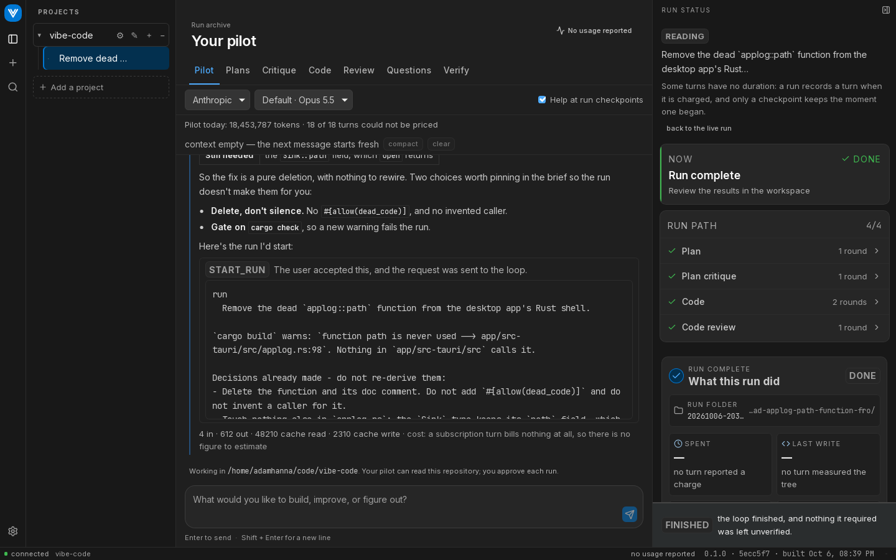
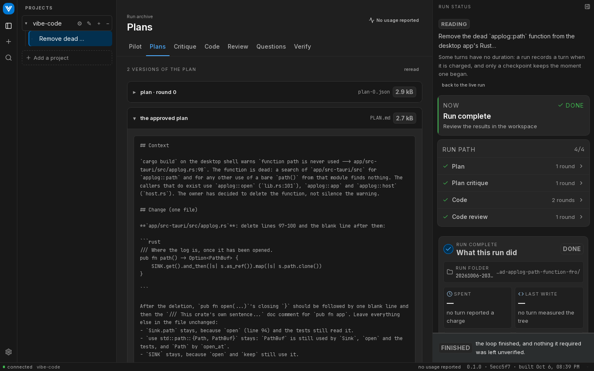
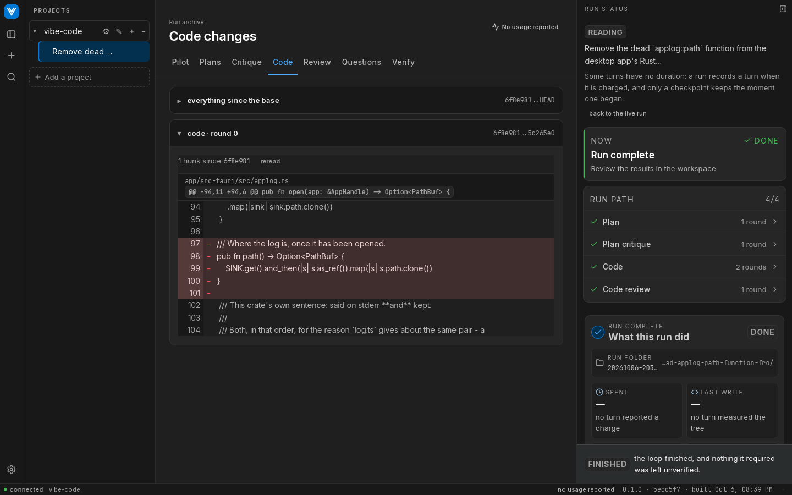

## What it does

A planner writes a plan and a critic attacks it, until the plan has no blocking findings. Then an implementer writes the code, vibe runs your tests itself, and a reviewer reviews the diff, until that is clean too.

By default Claude plans and implements, and Codex critiques, reviews and answers the planner's questions. Each of those roles can be seated on either Claude or Codex, with its own model and effort: see [`roles`](./configuration#roles). The plan critique and the review can each seat more finders and a vote of verifiers: see [`critique`](./configuration#critique) and [`review`](./configuration#review).

```
PLAN ──> CRITIQUE ──blocking?──> REVISE ─┐        the critic, any finders, and a vote
  │         │ clear                   └──┘
  │         v
  │      IMPLEMENT
  │         v
  │      VERIFY ──fails?──> FIX ─┐        your test suite, run by vibe
  │         │ passes          └──┘
  │         v
  │      REVIEW ──blocking?──> FIX ─┐        the reviewer, any finders, and a vote
  │         │ clear              └──┘
  └─────────v  DONE
```

## Install

```bash
npm install -g @adam-hanna/vibe-code
vibe doctor
```

You need `claude` and `codex` installed and logged in. vibe installs neither: it runs them as child processes, so they use the subscriptions you already have. Node 20+. [Getting started](./getting-started) has the rest.

## The desktop app

The same loop with a window around it. You describe what you want to the pilot, a chat that can read your repository. Once the brief is clear it proposes a run for you to start.







See [The desktop app](./app).
